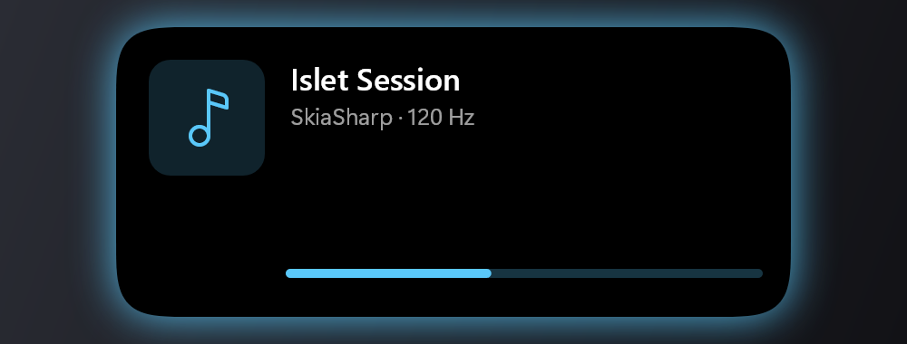
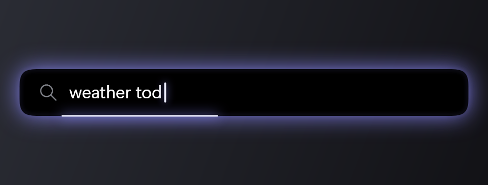

<div align="center">

# Islet

### A living, adaptive status pill for Windows 11

Islet brings an iOS-style “island” to the top of your Windows desktop — a smooth black pill that
morphs between shapes to show whatever is happening right now: music, timers, charging, volume,
mic/camera activity, and a glowing **Ask** search field. Built from scratch with .NET 9, Win32/DWM
and a custom SkiaSharp renderer with a real spring-physics animation engine.

**.NET 9 · WPF host · Win32 layered window · SkiaSharp · custom spring engine · 120 Hz**


</div>

---

## Overview

Islet is a single lightweight tray app. It paints one topmost, click-through, per-pixel-shaped window
at the top-center of your display and animates it entirely with springs — size, corner radius and
position are physical, interruptible animations, never crossfades. Content is drawn by a Skia renderer
and clipped to a **continuous squircle** (a superellipse, not a plain rounded rectangle), with a soft
activity-colored glow.

<div align="center">

| Idle | Compact | Minimal (gooey) |
|:---:|:---:|:---:|
|  |  |  |

| Expanded | Ask |
|:---:|:---:|
|  |  |

</div>

## Features

- **Six states** — Idle · Compact · Minimal · Expanded · Alert · Ask — all spring-animated and interruptible.
- **Liquid “gooey” split** — when a second activity appears it separates from the pill as a metaball blob.
- **Ask field** — a hotkey morphs the pill into a “Search or Ask” bar with a blinking glowing caret and a
  thin highlight that runs around the contour; the query is dispatched to Windows Search, a command, or a
  local HTTP endpoint.
- **Live activities (plugin model):**
  - **Media** via the System Media Transport Controls — works with **any** app: SoundCloud, Spotify,
    YouTube, browsers, Media Player, VLC… (artwork, live progress, source label, derived glow color).
  - **Battery** (charging / low), **Volume** HUD, **Mic / Camera** privacy indicator, **Timer**, **Caps Lock**.
- **Good citizen** — topmost but never steals focus, hidden from Alt+Tab and the taskbar, click-through on
  transparent pixels, Per-Monitor-V2 DPI aware, auto-hides during fullscreen games and on the lock screen.
- **No administrator rights.** Single-file, self-contained build for x64 and ARM64.

<!-- APPEND_README -->

## Install

**Option A — download a release build**

1. Grab `Islet.exe` for your architecture (x64 or ARM64) from the Releases page.
2. Run it. The pill appears at the top of your primary monitor and an icon is added to the tray.
3. (Optional) Use the installer (`installer/Islet.iss`, Inno Setup) to add a Start-menu entry and a
   “start at sign-in” shortcut — a per-user install with no admin prompt.

**Option B — build it yourself** → see [Build from source](#build-from-source).

## Usage

| Action | Result |
|--------|--------|
| **Win + Alt + Space** | Toggle the **Ask** field — type a query and press **Enter** (Esc cancels) |
| **Click** the pill | Expand / collapse the current activity |
| **Hover** the pill | Expand (can be disabled in config) |
| **Tray → menu** | Ask · start a timer · open the config folder · quit |

Just start playing music (SoundCloud in a browser, Spotify, etc.), plug in the charger, change the
volume, or start a timer from the tray — the island reacts automatically.

## Configuration

A `config.json` is created at `%APPDATA%\Islet\config.json` on first run. Everything is tunable and
hot — edit the file and restart:

- **Layout** — rest size, top margin, per-state sizes, corner “squircle” exponent, glow radius/strength.
- **Springs** — `response` and `dampingFraction` for geometry / content / snappy springs.
- **Timings** — content crossfade, alert dwell, caret blink, border-sweep period.
- **Behavior** — hotkey, monitor preference, hide-on-fullscreen / lock, hover-to-expand, and the Ask
  handler: `WindowsSearch` (default) · `Command` (run a program) · `Http` (POST `{"query": …}` to a local
  endpoint, e.g. a local AI model).
- **Colors** — default glow, Ask-mode glow, accent.

## Build from source

Requires the .NET SDK (9 or 10) on Windows 10 1809+ / Windows 11.

```bash
git clone <your-repo-url> islet
cd islet
dotnet build Islet.slnx -c Release
dotnet run --project src/Islet/Islet.csproj
```

Publish a self-contained single file:

```bash
pwsh scripts/publish.ps1              # win-x64 and win-arm64 -> dist/<rid>/Islet.exe
pwsh scripts/publish.ps1 -Rid win-x64
```

Handy diagnostic flags: `--render-probe <dir>` (render every state to PNGs), `--showcase <dir> [s] [fps]`
(render the motion sequence to frames), `--media-test`, `--audio-test`, `--demo`.

<!-- APPEND_README2 -->

## Project structure

```
src/
  Islet.Core/        pure, unit-tested: spring engine, continuous-squircle geometry,
                     state model, config, the ILiveActivity plugin contract
  Islet/             the app (WPF host, net9.0-windows)
    Interop/         hand-written Win32 P/Invoke + Core Audio COM; CsWin32 leaf APIs
    Rendering/       LayeredSurface (DIB + UpdateLayeredWindow), IslandRenderer,
                     SquirclePath, MinimalShape (metaball), ContentRenderer, AskDecoration
    Activities/      ActivityManager + Media / Battery / Volume / Recording / Timer / CapsLock
    IslandWindow · IslandController · SystemWatcher · AskInput · TrayIcon · ConfigStore
tests/Islet.Tests/   xUnit tests (spring + geometry)
docs/                SPEC.md (states, sizes, timings, springs) · ASSUMPTIONS.md
installer/           Inno Setup script (per-user, no admin)
scripts/             publish.ps1
```

How it works, briefly: a dedicated thread owns a borderless `WS_EX_LAYERED | TOOLWINDOW | NOACTIVATE |
TOPMOST` window. Each frame the spring state is advanced, Skia draws the island into a top-down 32-bpp
premultiplied DIB, and `UpdateLayeredWindow` blits it with true per-pixel alpha; the loop is paced to the
compositor with `DwmFlush`. Hit-testing is done against the live shape, so clicks pass through everywhere
the pill isn’t.

See [docs/SPEC.md](docs/SPEC.md) for the exact geometry, timings and spring parameters, and
[docs/ASSUMPTIONS.md](docs/ASSUMPTIONS.md) for design decisions and estimates.

## Roadmap

- Window parking: stash a window to the screen edge / into the island and restore it with a click.
- More system HUDs: brightness, Wi-Fi, Bluetooth & headphones.
- Windows notification mirroring (`UserNotificationListener`, requires packaged identity) and
  download/copy progress.
- A small settings UI over `config.json`.

## License

Released under the MIT License — see [LICENSE](LICENSE).

> Not affiliated with, authorized by, or endorsed by Apple. “Dynamic Island”, SF Pro and SF Symbols are
> trademarks of Apple Inc. and are **not** used here — Islet ships its own name, Segoe UI Variable
> typography and Segoe Fluent iconography.


